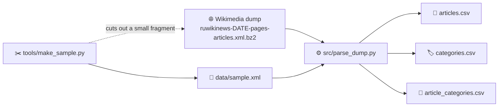

🌐 [Read in Russian](README.ru.md)

<div align="center">

# 📰 wikinews-corpus

**Parser for the Russian Wikinews XML dump: from the raw dump to three clean CSV files**


</div>

A course project (coursework) on building a news corpus model and an algorithm for extracting semi-structured data. The Wikinews dump is an XML file with wiki markup inside. The program reads it as a stream, extracts the event date, categories and text origin, cleans the text, and writes the result to three linked tables.

There are no external libraries: only Python is required.

---

## 📑 Contents

1. [How it works](#-how-it-works)
2. [Repository structure](#-repository-structure)
3. [Quick start in two minutes](#-quick-start-in-two-minutes)
4. [What you get](#-what-you-get)
5. [Working with the real dump](#-working-with-the-real-dump)
6. [Making your own sample](#-making-your-own-sample)
7. [Running on the full dump](#-running-on-the-full-dump)
8. [Extraction rules](#-extraction-rules)
9. [Known limitations](#-known-limitations)
10. [Reproducibility](#-reproducibility)
11. [Useful links](#-useful-links)

---

## 🧭 How it works



The work has two stages. First, a small fragment is cut out of the huge dump, so that the rules are easy to check and debug on it. Then the same parser is run unchanged on the full dump.

---

## 🗂 Repository structure

```text
wikinews-corpus/
├── README.md               this file (English)
├── README.ru.md            description in Russian
├── .gitignore
├── src/
│   └── parse_dump.py       parser: XML (or XML.bz2) -> three CSV files
├── tools/
│   ├── make_sample.py      cuts a small fragment out of a large dump
│   └── compress_zst.py     compresses CSV files to .zst (no zstd install needed)
├── examples/
│   └── load_from_hf.py     example: reading the dataset from Hugging Face
├── hf/
│   └── DATASET_CARD.md     card (README) of the dataset on Hugging Face
└── data/
    ├── sampleMINI.xml      2 pages: the shortest example for a first run
    └── sample.xml          50 pages: a working fragment for debugging
```

The full dump is not stored in the repository: it is too large for regular Git and is listed in `.gitignore`. The `output/` folder with results is not stored either.

---

## 🚀 Quick start in two minutes

You do not need to download the dump for this step: the required files are already in `data/`.

**1. Check Python** (version 3.9 or newer is required):

```bash
python --version
```

On Linux and macOS the command may be called `python3`, on Windows sometimes `py`.

**2. Get the repository:**

```bash
git clone https://github.com/<your-username>/wikinews-corpus.git
cd wikinews-corpus
```

**3. Run the parser on the smallest example:**

```bash
python src/parse_dump.py data/sampleMINI.xml -o output/
```

Expected output:

```text
Схема v0.1-lite. Готово: {'seen': 2, 'written': 1, 'skipped_ns': 0, 'skipped_redirect': 1}
```

(The message is printed in Russian: "Schema v0.1-lite. Done".) Of the two pages, one became an article, and the other was a redirect (`Main Page`) and was skipped.

**4. Run it on the working fragment:**

```bash
python src/parse_dump.py data/sample.xml -o output/
```

Expected output:

```text
Схема v0.1-lite. Готово: {'seen': 50, 'written': 48, 'skipped_ns': 0, 'skipped_redirect': 2}
```

> 💡 Paths in the commands are written with `/`. Python accepts this form in Windows cmd as well, so the commands are the same on all systems.

---

## 📦 What you get

Three UTF-8 files appear in the `output/` folder:

| File | One row is | Fields |
|---|---|---|
| `articles.csv` | one article | `page_id`, `title`, `date`, `origin_type`, `origin_name`, `text_plain` |
| `categories.csv` | one unique category | `category_id`, `name` |
| `article_categories.csv` | an "article – category" link | `page_id`, `category_id` |

Categories are moved to separate tables so that their names are not repeated in every article. This is a many-to-many relation: an article has many categories, and a category belongs to many articles. Each `page_id`, `category_id` pair occurs in `article_categories.csv` only once.

### What is intentionally not written

The schema is slimmed down so that the CSV files take less space and load faster on the large dump. The output files **do not contain**:

- the raw date string (`event_date_raw`): only the normalized date in the `date` field is kept;
- wikitext with preserved links (`text_wikitext`): only `text_plain` is kept;
- the parsing flags `has_sources_section`, `parse_status`, `parse_notes`;
- the origin of an article–category link (`source`).

On `data/sample.xml` this reduced `articles.csv` from 357 kB to 161 kB and `article_categories.csv` from 14 kB to 5 kB.

### Example: the article from `sampleMINI.xml`

This is how the only article of that file looks in `articles.csv`:

| Field | Value |
|---|---|
| `page_id` | `1349` |
| `title` | `Россия удивлена заявлениями Премьер-министра Украины и хочет разъяснений` ("Russia is surprised by the statements of the Prime Minister of Ukraine and wants clarifications") |
| `date` | `2005-11-03` |
| `origin_type` | `unknown` |
| `origin_name` | empty |
| `text_plain` | text without markup: «В Москве обратили внимание на сообщения СМИ…» ("Moscow noted media reports…") |

> ⚠️ At the start of this article's `text_plain` a stray `]]` remains from an image caption that contains a nested link. This is a known limitation, see "Known limitations".

From the `{{Категории|...}}` template ("categories"), the `{{тема}}` template ("topic") and two `[[Категория:...]]` links, 29 unique categories (`categories.csv`) and 29 links (`article_categories.csv`) were produced. The category "Международные отношения" ("International relations") is listed in both `{{тема}}` and `{{Категории}}`, but is recorded only once in the links.

```csv
page_id,category_id
1349,1
1349,2
1349,3
```

---

## 🌐 Working with the real dump

### Step 1. Install the tools

<details>
<summary><b>🪟 Windows</b></summary>

- Python: [python.org/downloads](https://www.python.org/downloads/). In the installer, tick **Add python.exe to PATH**.
- Git: [git-scm.com](https://git-scm.com/).
- Check in the command prompt (cmd): `python --version` and `git --version`. If `python` is not found, try `py --version`.

</details>

<details>
<summary><b>🐧 Linux / 🍎 macOS</b></summary>

Python 3 and Git are usually already installed. Check with `python3 --version` and `git --version`. If something is missing, install it with your package manager (`apt`, `dnf`, `brew`).

</details>

### Step 2. Download the dump

Dumps of the Russian Wikinews are published on the official Wikimedia server:

👉 **https://dumps.wikimedia.org/ruwikinews/**

Inside, the folders are grouped by dates in the form `YYYYMMDD`. Open the date you need (for example, `20260901`) or the `latest` folder, and download the file:

```text
ruwikinews-YYYYMMDD-pages-articles.xml.bz2
```

It contains the current versions of all pages. The variant `ruwikinews-YYYYMMDD-pages-articles-multistream.xml.bz2` also works: the parser reads both. The index file (`...multistream-index.txt.bz2`) is not needed by this program.

> 📌 Unpacking the archive is not required: the parser and `make_sample.py` read `.bz2` directly. If the file is already unpacked to `.xml`, they read that too, and faster.

Next to it on the page there are checksum files (`ruwikinews-YYYYMMDD-sha1sums.txt` and `...md5sums.txt`). Compare the checksum of the downloaded file with the published one:

```bash
# Linux / macOS
sha1sum ruwikinews-YYYYMMDD-pages-articles.xml.bz2
```

```bat
:: Windows (cmd)
certutil -hashfile ruwikinews-YYYYMMDD-pages-articles.xml.bz2 SHA1
```

Put the dump **outside the repository** (for example, in `D:\dumps\`) or in the `data/` folder under a name that `.gitignore` will not let into a commit (`*.bz2` is excluded).

### Step 3. Look at how the dump is organized

Before writing rules it helps to see the structure of the file. You do not need to open the whole dump: take a small fragment (next section) and open it in any editor.

```bash
# Windows (cmd): page through the file, quit with q
more data/sample.xml

# Linux / macOS
less data/sample.xml
```

Or simply open `data/sample.xml` in Notepad, VS Code or `vim -R`. The structure of a page is as follows:

```xml
<page>
  <title>Article title</title>
  <ns>0</ns>                      namespace (0 is a main-namespace article)
  <id>1349</id>                   page identifier
  <revision>
    <timestamp>...</timestamp>
    <contributor>...</contributor>
    <text>{{Дата|3 ноября 2005}} ... wiki markup ...</text>
  </revision>
</page>
```

A redirect is distinguished by the `<redirect title="..."/>` tag and the text `#REDIRECT [[...]]`.

---

## ✂️ Making your own sample

Working with a gigabyte-sized file right away is inconvenient: every run is long, and a mistake in the rules is hard to find among millions of lines. That is why a small fragment is cut out of the dump, which you can read by eye, commit to Git and run quickly.

`tools/make_sample.py` does this. It keeps the file header (`<mediawiki>`, `<siteinfo>`) and closes `</mediawiki>` itself, so all tags in the result are paired.

### Option 1. The first N articles

```bash
python tools/make_sample.py path/to/dump.xml.bz2 data/sample.xml --pages 50
```

Takes the first 50 pages of the main namespace. This is the simplest option, but pages in the dump go in ascending `page_id` order, so the oldest articles come first (in `data/sample.xml` this is the year 2005). Rare cases such as the interview template or a bot upload may not be there.

### Option 2. Specific articles by topic (by a word in the title)

```bash
python tools/make_sample.py path/to/dump.xml.bz2 data/sample.xml --title "Космонавты" --title "чемпионат"
```

Takes all pages whose title contains the given substring (case-insensitive). The `--title` option can be repeated. (The titles are in Russian, so the substrings are too: "Космонавты" means "Cosmonauts", "чемпионат" means "championship".) This is convenient for collecting a **topic selection** or for picking out articles to test the rules: with the `{{Эксклюзивное интервью}}` template ("exclusive interview"), with `{{Загружено ботом}}` ("uploaded by a bot"), without a date, or with a non-standard sources section.

> ⚠️ The search is by **title** only, not by text or category. If you need a topic selection by category, first obtain it from `articles.csv` (a selection through `article_categories.csv`), then find the titles of the articles you need and pass them to `--title`.

### Option 3. A combination (recommended)

```bash
python tools/make_sample.py path/to/dump.xml.bz2 data/sample.xml --pages 30 --title "Лёвочкин" --title "Обводном канале"
```

The first 30 articles provide a "background", and the ones chosen by title add rare cases.

> ⏱ The `--pages` mode stops right after the required number of articles and finishes in seconds. With `--title` the program goes through the file until it finds all the titles, and if an article is near the end of the dump, it reads almost the whole file. If a title is not found, the script reports it after scanning the whole file.

### Check that the XML is valid

```bash
python -c "import xml.dom.minidom as m; d = m.parse('data/sample.xml'); print('OK, pages:', len(d.getElementsByTagName('page')))"
```

If all tags are closed, the command prints `OK` and the number of pages.

### What a good sample should contain

- a regular article with a date and a "Sources" section;
- an article without a date;
- an article with several categories from different templates;
- a bot import and an original interview (if you need the origin rules);
- a redirect (the parser must skip it);
- an article with a table or non-standard markup, where something can go wrong.

---

## ▶️ Running on the full dump

When the rules work as expected on the sample:

```bash
python src/parse_dump.py path/to/ruwikinews-YYYYMMDD-pages-articles.xml.bz2 -o output/
```

The parser reads the XML as a stream: each page is processed and immediately forgotten, so memory does not grow with the size of the dump. The time depends on the computer. When finished, a summary is printed:

```text
Схема v0.1-lite. Готово: {'seen': ..., 'written': ..., 'skipped_ns': ..., 'skipped_redirect': ...}
```

| Counter | Meaning |
|---|---|
| `seen` | how many pages were examined |
| `written` | how many articles went into `articles.csv` |
| `skipped_ns` | pages skipped because they are not in the main namespace |
| `skipped_redirect` | redirects skipped |

Command-line options:

```text
python src/parse_dump.py XML [-o DIR]

XML          path to .xml or .xml.bz2
-o, --out    output folder (default: output)
```

---

## 📐 Extraction rules

| What | How it is determined |
|---|---|
| **Page selection** | only the main namespace (`ns = 0`); redirects are skipped |
| **`page_id`** | from `<page><id>`, not from the revision id |
| **Title `title`** | from `<page><title>`, unchanged |
| **Event date `date`** | only from the `{{дата\|...}}` template ("date"; the first one is used), in `YYYY-MM-DD` format. No template or an unrecognized format: the field is empty, and the article is **not dropped** |
| **Categories** | from the `{{тема}}` ("topic") and `{{Категории}}` ("categories") templates and from `[[Категория:...]]` links; duplicates are merged |
| **Origin** | `{{Загружено ботом...}}` ("uploaded by a bot") gives `external_import` (the source name is taken from the template's second parameter); `{{Эксклюзивное интервью...}}` ("exclusive interview") gives `wikinews_original`; otherwise `unknown` |
| **"Sources" section** | recognized at any heading level (`==`, `===`, ...); it is cut off from the text together with everything that follows it |
| **Text `text_plain`** | plain readable text without wiki markup: service templates and categories are removed, `[[...]]` links are replaced with their label |

Templates are parsed by counting the nesting of `{{ }}` and `[[ ]]` rather than with a single regular expression, so nested parameters and links inside templates do not break parsing.

The key difference from the approach of S. N. Karpovich (SCTM-ru, 2015): articles without a date are not excluded, the author of the last revision is not treated as the author of the text, and information from service templates is first extracted and only then removed from the text.

---

## ⚠️ Known limitations

This is a first version, and some cases are still handled in a simplified way:

- Only a section called "Источники" ("Sources") is cut off. In some older articles the analogous block is called "Ссылки" ("Links"), and it stays in `text_plain`.
- In `text_plain`, all templates not recognized as service templates (for example, `{{Космонавтика}}`, `{{публиковать}}`) are removed completely, together with their parameters. If such a template carried meaningful text, it is lost.
- Wiki tables `{| ... |}` and HTML entities (for example, `&frac12;`) are not processed in `text_plain`.
- Nested links in a file caption, for example `[[Файл:...|caption [[link]]]]`, can leave stray `]]` characters at the start of `text_plain`.
- If an article has several `{{дата}}` templates, the first is used and the rest are ignored.
- If a date cannot be converted to `YYYY-MM-DD` (for example, "начало февраля 2011", "early February 2011"), `date` stays empty and the raw value is not saved. There are no parsing quality flags in the CSV any more.

---

## 🔁 Reproducibility

To be able to get the result again, record the following for every run:

```text
dump file name            ruwikinews-YYYYMMDD-pages-articles.xml.bz2
dump date                 YYYY-MM-DD
checksum                  SHA-1 or SHA-256 of the downloaded file
Python version            python --version
schema version            v0.1-lite (printed by the parser)
commit of this repository git rev-parse HEAD
```

Then anyone can download the same dump, run the same version of the code and obtain the same three CSV files.

---

## 🔗 Useful links

- [Russian Wikinews dumps](https://dumps.wikimedia.org/ruwikinews/)
- [Wikimedia: dump format](https://meta.wikimedia.org/wiki/Data_dumps/Dump_format)
- [Wikimedia: dumps FAQ](https://meta.wikimedia.org/wiki/Data_dumps/FAQ)
- S. N. Karpovich. "SCTM-ru: a Russian-language text corpus for building topic models" (in Russian), 2015
