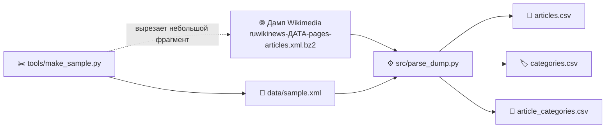

🌐 [Read in English](README.md)

<div align="center">

# 📰 wikinews-corpus

**Парсер XML-дампа Русских Викиновостей: из «сырого» дампа в три чистых CSV**


</div>

Учебный проект (курсовая работа) по теме разработки модели новостного корпуса и алгоритма извлечения слабоструктурированных данных. Дамп Викиновостей представляет собой XML, внутри которого лежит вики-разметка. Программа читает его потоково, достаёт дату события, категории, происхождение текста, очищает текст и записывает результат в три связанные таблицы.

Внешних библиотек нет: нужен только Python.

---

## 📑 Оглавление

1. [Как это устроено](#-как-это-устроено)
2. [Структура репозитория](#-структура-репозитория)
3. [Быстрый старт за две минуты](#-быстрый-старт-за-две-минуты)
4. [Что получается на выходе](#-что-получается-на-выходе)
5. [Работа с настоящим дампом](#-работа-с-настоящим-дампом)
6. [Как сделать свой sample](#-как-сделать-свой-sample)
7. [Запуск на всём дампе](#-запуск-на-всём-дампе)
8. [Правила извлечения](#-правила-извлечения)
9. [Известные ограничения](#-известные-ограничения)
10. [Воспроизводимость](#-воспроизводимость)
11. [Полезные ссылки](#-полезные-ссылки)

---

## 🧭 Как это устроено



Работа идёт в два этапа. Сначала из огромного дампа вырезается небольшой фрагмент, на котором удобно проверять и отлаживать правила. Затем тот же парсер без изменений запускается на полном дампе.

---

## 🗂 Структура репозитория

```text
wikinews-corpus/
├── README.md               описание на английском
├── README.ru.md            описание на русском (этот файл)
├── .gitignore
├── src/
│   └── parse_dump.py       парсер: XML (или XML.bz2) -> три CSV
├── tools/
│   ├── make_sample.py      вырезает небольшой фрагмент из большого дампа
│   └── compress_zst.py     сжимает CSV в .zst (установка zstd не нужна)
├── examples/
│   └── load_from_hf.py     пример: чтение набора данных с Hugging Face
├── hf/
│   └── DATASET_CARD.md     карточка (README) набора данных на Hugging Face
└── data/
    ├── sampleMINI.xml      2 страницы: самый короткий пример для первого запуска
    └── sample.xml          50 страниц: рабочий фрагмент для отладки
```

Полный дамп в репозиторий не кладётся: он слишком велик для обычного Git и перечислен в `.gitignore`. Папка `output/` с результатами тоже не хранится в репозитории.

---

## 🚀 Быстрый старт за две минуты

Для этого шага скачивать дамп не нужно: нужные файлы уже лежат в `data/`.

**1. Проверьте Python** (нужна версия 3.9 или новее):

```bash
python --version
```

В Linux и macOS команда может называться `python3`, в Windows иногда `py`.

**2. Скачайте репозиторий:**

```bash
git clone https://github.com/<ваш-логин>/wikinews-corpus.git
cd wikinews-corpus
```

**3. Запустите парсер на самом маленьком примере:**

```bash
python src/parse_dump.py data/sampleMINI.xml -o output/
```

Ожидаемый вывод:

```text
Схема v0.1-lite. Готово: {'seen': 2, 'written': 1, 'skipped_ns': 0, 'skipped_redirect': 1}
```

Из двух страниц одна стала статьёй, а вторая оказалась редиректом (`Main Page`) и была пропущена.

**4. Запустите на рабочем фрагменте:**

```bash
python src/parse_dump.py data/sample.xml -o output/
```

Ожидаемый вывод:

```text
Схема v0.1-lite. Готово: {'seen': 50, 'written': 48, 'skipped_ns': 0, 'skipped_redirect': 2}
```

> 💡 В командах пути записаны через `/`. Python принимает такой вариант и в Windows cmd, поэтому команды одинаковы на всех системах.

---

## 📦 Что получается на выходе

В папке `output/` появляются три файла в кодировке UTF-8:

| Файл | Одна строка это | Поля |
|---|---|---|
| `articles.csv` | одна статья | `page_id`, `title`, `date`, `origin_type`, `origin_name`, `text_plain` |
| `categories.csv` | одна уникальная категория | `category_id`, `name` |
| `article_categories.csv` | связь «статья и категория» | `page_id`, `category_id` |

Категории вынесены в отдельные таблицы, чтобы не повторять их названия в каждой статье. Связь многие ко многим: у статьи много категорий, а категория относится ко многим статьям. Каждая пара `page_id`, `category_id` встречается в `article_categories.csv` один раз.

### Что намеренно не записывается

Схема облегчена, чтобы CSV занимали меньше места и быстрее считывались на большом дампе. В выходные файлы **не попадают**:

- сырая строка даты (`event_date_raw`): остаётся только нормализованная дата в поле `date`;
- вики-текст с сохранёнными ссылками (`text_wikitext`): остаётся только `text_plain`;
- признаки разбора `has_sources_section`, `parse_status`, `parse_notes`;
- источник связи статья-категория (`source`).

На `data/sample.xml` это уменьшило `articles.csv` с 357 КБ до 161 КБ, а `article_categories.csv` с 14 КБ до 5 КБ.

### Пример: статья из `sampleMINI.xml`

Так выглядит единственная статья этого файла в `articles.csv`:

| Поле | Значение |
|---|---|
| `page_id` | `1349` |
| `title` | `Россия удивлена заявлениями Премьер-министра Украины и хочет разъяснений` |
| `date` | `2005-11-03` |
| `origin_type` | `unknown` |
| `origin_name` | пусто |
| `text_plain` | текст без разметки: «В Москве обратили внимание на сообщения СМИ…» |

> ⚠️ В начале `text_plain` этой статьи остался хвост `]]` от подписи к картинке с вложенной ссылкой. Это известное ограничение, см. раздел «Известные ограничения».

Из шаблона `{{Категории|...}}`, шаблона `{{тема}}` и двух ссылок `[[Категория:...]]` получилось 29 уникальных категорий (`categories.csv`) и 29 связей (`article_categories.csv`). Категория «Международные отношения» указана и в `{{тема}}`, и в `{{Категории}}`, но в связях она записана один раз.

```csv
page_id,category_id
1349,1
1349,2
1349,3
```

---

## 🌐 Работа с настоящим дампом

### Шаг 1. Установите инструменты

<details>
<summary><b>🪟 Windows</b></summary>

- Python: [python.org/downloads](https://www.python.org/downloads/). В установщике отметьте галочку **Add python.exe to PATH**.
- Git: [git-scm.com](https://git-scm.com/).
- Проверка в командной строке (cmd): `python --version` и `git --version`. Если `python` не находится, попробуйте `py --version`.

</details>

<details>
<summary><b>🐧 Linux / 🍎 macOS</b></summary>

Python 3 и Git обычно уже установлены. Проверка: `python3 --version` и `git --version`. Если чего-то не хватает, поставьте через пакетный менеджер (`apt`, `dnf`, `brew`).

</details>

### Шаг 2. Скачайте дамп

Дампы Русских Викиновостей лежат на официальном сервере Wikimedia:

👉 **https://dumps.wikimedia.org/ruwikinews/**

Внутри папки сгруппированы по датам вида `ГГГГММДД`. Откройте нужную дату (например, `20260901`) или папку `latest`, затем скачайте файл:

```text
ruwikinews-ГГГГММДД-pages-articles.xml.bz2
```

В нём лежат текущие версии всех страниц. Подойдёт и вариант `ruwikinews-ГГГГММДД-pages-articles-multistream.xml.bz2`: парсер читает оба. Файл индекса (`...multistream-index.txt.bz2`) для этой программы не нужен.

> 📌 Распаковывать архив не обязательно: парсер и `make_sample.py` читают `.bz2` напрямую. Если файл уже распакован в `.xml`, они прочитают и его, причём быстрее.

Рядом на странице лежат файлы контрольных сумм (`ruwikinews-ГГГГММДД-sha1sums.txt` и `...md5sums.txt`). Сверьте сумму скачанного файла с опубликованной:

```bash
# Linux / macOS
sha1sum ruwikinews-ГГГГММДД-pages-articles.xml.bz2
```

```bat
:: Windows (cmd)
certutil -hashfile ruwikinews-ГГГГММДД-pages-articles.xml.bz2 SHA1
```

Положите дамп **вне репозитория** (например, в `D:\dumps\`) или в папку `data/` под именем, которое `.gitignore` не пропустит в коммит (`*.bz2` исключён).

### Шаг 3. Посмотрите, как устроен дамп

Прежде чем писать правила, полезно увидеть структуру файла. Весь дамп открывать не нужно: возьмите небольшой фрагмент (следующий раздел) и откройте его в любом редакторе.

```bash
# Windows (cmd): листать по экрану, выход: q
more data/sample.xml

# Linux / macOS
less data/sample.xml
```

Или просто откройте `data/sample.xml` в Блокноте, VS Code или `vim -R`. Структура страницы такая:

```xml
<page>
  <title>Заголовок статьи</title>
  <ns>0</ns>                      пространство имён (0 это основная статья)
  <id>1349</id>                   идентификатор страницы
  <revision>
    <timestamp>...</timestamp>
    <contributor>...</contributor>
    <text>{{Дата|3 ноября 2005}} ... вики-разметка ...</text>
  </revision>
</page>
```

Редирект отличается тегом `<redirect title="..."/>` и текстом `#REDIRECT [[...]]`.

---

## ✂️ Как сделать свой sample

Работать сразу с гигабайтом неудобно: любой запуск долгий, а ошибку в правилах трудно найти среди миллионов строк. Поэтому из дампа вырезают небольшой фрагмент, который можно открыть глазами, закоммитить в Git и быстро прогнать.

Для этого есть `tools/make_sample.py`. Он сохраняет шапку файла (`<mediawiki>`, `<siteinfo>`) и сам закрывает `</mediawiki>`, так что в результате все теги парные.

### Способ 1. Первые N статей

```bash
python tools/make_sample.py путь/к/дампу.xml.bz2 data/sample.xml --pages 50
```

Берёт первые 50 страниц основного пространства имён. Это самый простой вариант, но в дампе страницы идут по возрастанию `page_id`, поэтому в начале лежат самые старые статьи (в `data/sample.xml` это 2005 год). Редких случаев вроде шаблона интервью или загрузки ботом там может не быть.

### Способ 2. Конкретные статьи по теме (по слову в заголовке)

```bash
python tools/make_sample.py путь/к/дампу.xml.bz2 data/sample.xml --title "Космонавты" --title "чемпионат"
```

Берёт все страницы, в заголовке которых есть указанная подстрока (регистр не важен). Параметр `--title` можно повторять. Так удобно собирать **выборку по теме** или доставать статьи для проверки правил: с шаблоном `{{Эксклюзивное интервью}}`, с `{{Загружено ботом}}`, без даты, с нестандартным разделом источников.

> ⚠️ Поиск идёт именно по **заголовку**, а не по тексту и не по категории. Если нужна тематическая выборка по категории, сначала получите её из `articles.csv` (подборка по `article_categories.csv`), а затем найдите заголовки нужных статей и передайте их в `--title`.

### Способ 3. Комбинация (рекомендуется)

```bash
python tools/make_sample.py путь/к/дампу.xml.bz2 data/sample.xml --pages 30 --title "Лёвочкин" --title "Обводном канале"
```

Первые 30 статей дают «фон», а выбранные по заголовку добавляют редкие случаи.

> ⏱ Режим `--pages` останавливается сразу после нужного числа статей и работает за секунды. С `--title` программа идёт по файлу, пока не найдёт все заголовки, и если статья лежит в конце дампа, прочитает его почти целиком. Если заголовок не найден, скрипт напишет об этом после просмотра всего файла.

### Проверьте, что получился корректный XML

```bash
python -c "import xml.dom.minidom as m; d = m.parse('data/sample.xml'); print('OK, страниц:', len(d.getElementsByTagName('page')))"
```

Если все теги закрыты, команда напечатает `OK` и число страниц.

### Что должно быть в хорошем sample

- обычная статья с датой и разделом «Источники»;
- статья без даты;
- статья с несколькими категориями из разных шаблонов;
- импорт ботом и оригинальное интервью (если нужны правила происхождения);
- редирект (парсер должен его пропустить);
- статья с таблицей или нестандартной разметкой, где что-то может пойти не так.

---

## ▶️ Запуск на всём дампе

Когда правила на sample работают как надо:

```bash
python src/parse_dump.py путь/к/ruwikinews-ГГГГММДД-pages-articles.xml.bz2 -o output/
```

Парсер читает XML потоково: каждая страница обрабатывается и сразу забывается, поэтому память не растёт вместе с размером дампа. Время зависит от компьютера. По окончании напечатается итог:

```text
Схема v0.1-lite. Готово: {'seen': ..., 'written': ..., 'skipped_ns': ..., 'skipped_redirect': ...}
```

| Показатель | Что означает |
|---|---|
| `seen` | сколько страниц просмотрено |
| `written` | сколько статей попало в `articles.csv` |
| `skipped_ns` | пропущено страниц не из основного пространства имён |
| `skipped_redirect` | пропущено редиректов |

Параметры командной строки:

```text
python src/parse_dump.py XML [-o ПАПКА]

XML          путь к .xml или .xml.bz2
-o, --out    папка для результата (по умолчанию output)
```

---

## 📐 Правила извлечения

| Что | Как определяется |
|---|---|
| **Отбор страниц** | только основное пространство имён (`ns = 0`), редиректы пропускаются |
| **`page_id`** | из `<page><id>`, а не из идентификатора ревизии |
| **Заголовок `title`** | из `<page><title>`, без изменений |
| **Дата события `date`** | только из шаблона `{{дата\|...}}` (берётся первый), в формате `ГГГГ-ММ-ДД`. Нет шаблона или формат не распознан: поле пустое, статья **не удаляется** |
| **Категории** | из шаблонов `{{тема}}`, `{{Категории}}` и ссылок `[[Категория:...]]`; повторы объединяются |
| **Происхождение** | `{{Загружено ботом...}}` даёт `external_import` (название источника берётся из второго параметра шаблона); `{{Эксклюзивное интервью...}}` даёт `wikinews_original`; иначе `unknown` |
| **Раздел «Источники»** | распознаётся при любом уровне заголовка (`==`, `===`, ...), вместе со всем, что следует за ним, отсекается из текста |
| **Текст `text_plain`** | обычный читаемый текст без вики-разметки: служебные шаблоны и категории удалены, ссылки `[[...]]` заменены своей подписью |

Шаблоны разбираются со счётом вложенности `{{ }}` и `[[ ]]`, а не одним регулярным выражением, поэтому вложенные параметры и ссылки внутри шаблонов не ломают разбор.

Принципиальное отличие от подхода С. Н. Карповича (SCTM-ru, 2015): статьи без даты не исключаются, автор последней ревизии не считается автором текста, а информация из служебных шаблонов сначала извлекается и только потом удаляется из текста.

---

## ⚠️ Известные ограничения

Это первая версия, и часть случаев пока обрабатывается упрощённо:

- Раздел отсекается только если он называется «Источники». В части старых статей аналогичный блок называется «Ссылки», и он остаётся в `text_plain`.
- В `text_plain` все шаблоны, не распознанные как служебные (например, `{{Космонавтика}}`, `{{публиковать}}`), удаляются целиком вместе с параметрами. Если такой шаблон нёс содержательный текст, он теряется.
- Вики-таблицы `{| ... |}` и HTML-сущности (например, `&frac12;`) в `text_plain` не обрабатываются.
- Вложенные ссылки в подписи к файлу, например `[[Файл:...|подпись [[ссылка]]]]`, могут оставить в начале `text_plain` лишние символы `]]`.
- Если в статье несколько шаблонов `{{дата}}`, берётся первый, остальные игнорируются.
- Если дату не удалось привести к `ГГГГ-ММ-ДД` (например, «начало февраля 2011»), `date` остаётся пустым, а сырое значение не сохраняется. Признаков качества разбора в CSV больше нет.

---

## 🔁 Воспроизводимость

Чтобы результат можно было получить заново, фиксируйте для каждого запуска:

```text
имя файла дампа        ruwikinews-ГГГГММДД-pages-articles.xml.bz2
дата дампа             ГГГГ-ММ-ДД
контрольная сумма      SHA-1 или SHA-256 скачанного файла
версия Python          python --version
версия схемы           v0.1-lite (печатается парсером)
коммит этого репозитория   git rev-parse HEAD
```

Тогда любой человек сможет скачать тот же дамп, запустить ту же версию кода и получить те же три CSV.

---

## 🔗 Полезные ссылки

- [Дампы Русских Викиновостей](https://dumps.wikimedia.org/ruwikinews/)
- [Wikimedia: формат дампов](https://meta.wikimedia.org/wiki/Data_dumps/Dump_format)
- [Wikimedia: FAQ по дампам](https://meta.wikimedia.org/wiki/Data_dumps/FAQ)
- С. Н. Карпович. «Русскоязычный корпус текстов SCTM-ru для построения тематических моделей», 2015
